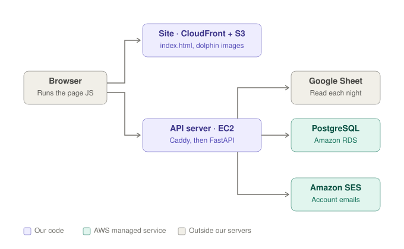
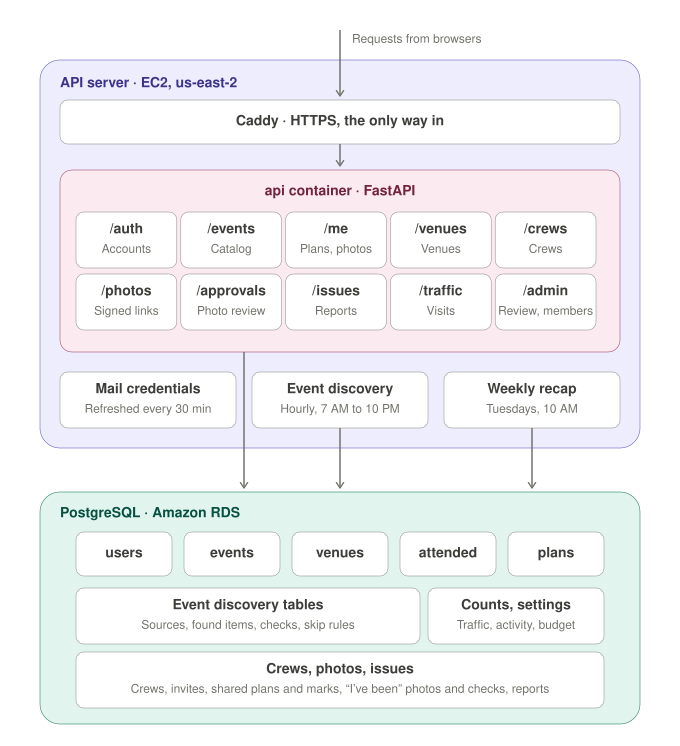
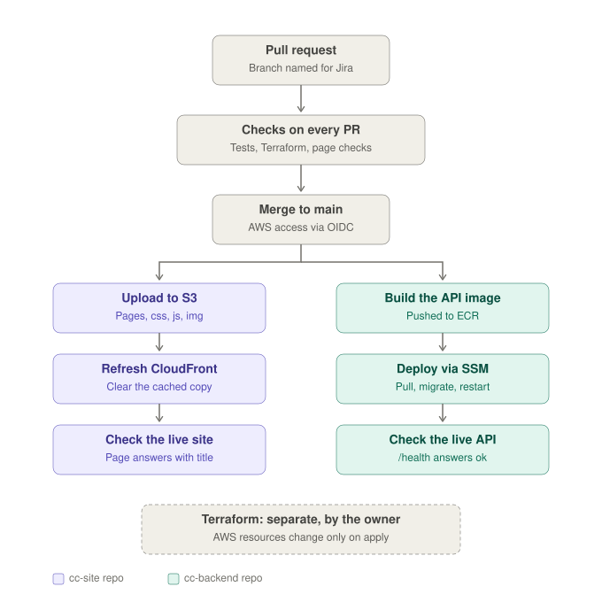

# Culture Crew: app structure

This document uses the rules of ASD-STE100 Simplified Technical English. No STE checker has verified it.

## Diagrams

The overview shows the parts and how they connect.

This diagram shows what runs on the API server and the tables in the database.

This diagram shows how a change goes from a pull request to production.

## 1. General

The Culture Crew app shows a list of cultural events in Chicago.
The app has two main parts: the site and the API.
The site shows the data. The API keeps the data.
Each part has its own repository on GitHub.

| Part | Repository | Function |
|---|---|---|
| Site | `cc-site` | Shows events to the user. Sends the user's actions to the API. |
| API | `cc-backend` | Keeps the events, users, plans and venues. Finds new events. Sends emails. |
| Infrastructure | `cc-backend/infra/aws` | Defines the AWS resources. |

## 2. The site

The site has these files:
- `public/index.html`: the HTML.
- `public/css/site.css`: the styles.
- `public/js/`: the scripts, one file for each area of the site. `water.js` draws the water patterns (see "The look" below).
- `public/img/`: the link-preview image. The dolphins are SVG symbols in `index.html`, not image files (CC-139).
- `scripts/`: the checks and tests that GitHub Actions runs (section 9), and the script that stamps the asset links.

The page loads the scripts in a fixed order. All the scripts share one global scope.
The site does not have a build step. At deploy, a script adds a content hash to each link to a style or script file.
Thus, browsers can keep these files for one year and still get each new version.
The fonts come from Google Fonts. The page links them in `index.html`.

Amazon S3 keeps the files.
Amazon CloudFront sends the files to the user's browser. Some paths come from the API instead: `/e/*` (CC-108: a plain HTML page per event, for search engines and link previews), `/chicago/*` (CC-109: roundup pages such as this weekend, free and $25 and under, closing soon, each kind and each side of town, linked from the footer), `/sitemap.xml` and `/robots.txt`. CloudFront caches them for up to 10 minutes. Inside the site, a listing row (CC-140) opens the event view at `#e/<id>` (CC-117), set as a poster (CC-142): the category field with its water, then the facts, Tickets, Interested and Going beside your crews'. Its Share button gives the `/e/` page, whose main button opens the view. Both show public takes (CC-112): Cultural Journal entries their members chose to share from #journal ("Share publicly" saves at once), which admins can hide from the event view. #planner is My week (CC-146): the week ahead a day at a time with your plans as event rows, Still deciding beside it, and a line to the Cultural Journal. #journal is the Cultural Journal (CC-159, from the you menu): the last five events you've been to, with only the entry being written open. `scripts/test_week.js` checks both in CI.
The join page, `chiculturecrew.com/join` (CC-121), is a copy of `index.html` with its own title and link-preview tags. The deploy makes the copy and puts it in S3 as the object `join`. The page then opens the join view: a sign-up box, with the catalog below it. Locally, nginx serves `index.html` at `/join` (`web.nginx.conf` in cc-backend).
The invite page, `chiculturecrew.com/invite` (CC-126), is the same join view with the admins' invite text. The deploy puts a copy of `index.html` with the invite page's preview tags in S3 as the object `invite`. An admin's "Invite a friend" opens this page. The visits and sign-ups count with the join page, with the source `invite` and the medium `link` or `qr`. Since CC-147 both pages, the Invite a friend dialog and its QR screen are Lakefront; the QR screen stays paper-white in both themes, and `scripts/test_invite.js` checks them in CI.

Your account (`#account`) and the pages the email links open (`#verify=`, `#reset=`; `start.js` routes them) are Lakefront since CC-148: Sign in beside "New here? Make an account", and, signed in, your profile and password beside the events you've sent us, your reports and photo approvals, with statuses as words. `scripts/test_account.js` checks their labels, autocomplete, statuses and errors in CI.
The browser runs the JavaScript.
The JavaScript gets the data from the API.

The site has these views:
- Home: a front page (CC-143). It has the full masthead, then the admin's picks. With two or more (up to 10), they form a swipeable stack across the row (CC-238, `leadstack.js`), with three ways in and Last chances (sorted by closing date) side by side below it. With one, it is the lead pick in three columns beside them. "The listings" follow as rows. On a phone, the columns stack.
- Join page (`/join`), and the invite page (`/invite`)
- Catalog
- Find an outing
- Submit an event: paste the event's link and the API fills in the form from the page (CC-124), or enter it by hand. The form opens as soon as the link is pasted, and the read fills only what the member hasn't typed (CC-215)
- Your account
- Review (admins only): a menu in the masthead (CC-206; `public/js/hubs.js`), a plain list under "Review" in the phone sheet. Its options are Waiting for review (the queue, `#review`) and three group pages of links with counts:
  - Event Sourcing (`#sourcing`, `public/js/sourcing.js`, CC-207): top to bottom, what needs the admin (the section goes when nothing does), a speedometer of the month's spend, a line graph of new events found, the found events by source, Hidden, and the tools. The link to the Source grid sits at the top, under the deck (CC-234). The numbers come from `/admin/discovery/summary`, which uses the weekly recap's own `gather()` and the budget guard's `budget_state()`, so the page, the email and the guard agree. The dial's zone is the guard's state. The graph's weeks are the recap's seven days counted back from now, so its latest point is the recap's number. A source's row opens to its events, as on Found events, with Edit/Approve, Delete and Hide. Found events group By source or By day (CC-208). By day is one list of the new events under day heads, undated last, from `GET /admin/discovery/items?order=day`, and Hidden stays with By source. Each new event has a tick box, and a bar sticks to the bottom of the list with Approve, Delete and Hide for those ticked. Only loaded events can be ticked, so nothing goes unseen. Check by hand only opens the Source grid filtered to those sources (`#sources/manual`), and two or more sources we couldn't read open it on just those (`#sources/unreadable`, the sources whose grid `state` is `error`, which is the rule the recap's unreadable list uses). The Source grid filters by how a source is checked and by its type. Each tool's back link returns to its group page.
  - Engagement (`#engagement`): Issues, Photo approvals, Site stats and the QR card
  - Venues and Members (`#people`): Venues and hours, and Members
- Venues, with each venue's hours and website (admins only). Above the list, "Suggested websites" offers a site for each venue that has none, from its event source or the CC-205 venue research. An admin confirms, edits or dismisses each one (CC-213). An "Add a venue" form above them adds a venue directly, and there the street, city and ZIP are required. It starts with a Website field: pasting an address reads the page (`POST /venues/from-website`, `app/venuelink.py`) and fills in the name, address and, for a suburb or where the page names one, the neighborhood. The page's schema.org data comes first, and Claude reads the page only if something is still missing, within the monthly budget and never on a site that opts out of AI. A field the admin typed in isn't replaced, nothing is saved until Add venue, and the form says what it couldn't find and which venue already has that website. The website is saved on the venue, so discovery gives it a source at its next run (CC-222). `scripts/test_venue_from_website.js` checks this in CI. "Suggested addresses" does the same for addresses seen in event data, and each venue shows its address or "No address yet", with a filter for the ones still missing (CC-218). The site covers Chicago and its suburbs, so a new or edited venue can only be City or Suburbs, and discovery leaves out events at an out-of-town venue (CC-217). Until an admin has run it, the "Out of town" clean-up above the list shows the venues still marked that way: Delete all out-of-town events, then Delete venue or Delete all empty out-of-town venues, each after an inline confirm. Their discovery sources are turned off first. The section hides once nothing is left. `scripts/test_out_of_town.js` checks this in CI. Each venue has Delete if no event uses it, or Hide if some do. Hide takes it out of the public venue list until an admin chooses Unhide, and its events stay listed. Rows say Hidden or Pending (CC-219). `scripts/test_hide_venue.js` checks this in CI.
- Site stats (admins only)
- Site health (admins only, `#health`, `public/js/health.js`, CC-244), from Engagement: whether the API and the database are answering (a trouble band for a server error or a missed database check in the last 15 minutes), the API's uptime, requests and recent server errors, call times (average, median, 95th and 99th percentiles, and the five slowest routes), the database's minute checks, and a pie of the responses other than 200 by status code (five slices, then Other). It covers the last hour, 24 hours, 7 days or 30 days, from `GET /admin/health`. The API keeps these itself (cc-backend `app/health.py`): each request's route pattern, status and time, never the path, query, body, address or user, written in a batch each minute and kept 30 days. AWS-level alarms are CC-192's. `scripts/test_health.js` checks this in CI.
- Source grid (admins only, `public/js/sourcegrid.js`, CC-221): a grid of blocks, one per source, with just the venue's name. Largest first, ties A to Z, and turned-off sources last. A block's colour is the API's `state`: green reads fine, pale yellow reads fine but has never found an event, light red can't be read, orange is checked by hand, grey hasn't been read yet, and an outline is turned off. Its size is one of four steps for the approved events at its venues, dated from 12 months ago onward (0–2, 3–9, 10–24, 25+). Hover, keyboard focus or a tap shows Events, Health and Settings. Each opens a panel under the block's row and pushes the rest down. `#source-<id>` opens that block's Health panel. A venue's website (Venue URL) and the pages read (Sourcing URL) are separate, and Settings edits both. `scripts/test_sources.js` checks this in CI.
- Found events (admins only)
- Issues (admins only). Each report has "Create Jira ticket" (CC-241). It opens a draft with a type, a priority, a summary and a description, with personal details taken out. The admin edits it and sends it, and the server makes one ticket in the CC project and links it to the report. The row then shows the ticket and its status in Jira. "Done" in Jira means deployed, not checked, so the report's own Fixed is still set by hand.
- Members and Photo approvals (admins; approvers see Photo approvals too)
- QR card (admins only)

Each view has its own address (CC-157): Home is the bare site, and the others are a hash, such as `#catalog`, `#account`, `#planner`, `#journal`, `#review` or `#stats`. An event is `#e/<id>`. Showing a view pushes its address onto the history (`syncAddress` in `util.js`). Back and Forward fire `popstate`, and `route()` in `start.js` opens the view in the address. A reload opens the view in the address, and so do links in emails. When an address redirects (an admin page for someone who isn't an admin opens Your account), the redirect replaces the history entry, so Back still works. `scripts/test_routing.js` checks this in CI.

The site has two themes: light, which is the default, and dark, called "Lights down".
The theme button names the change it will make (CC-161): it says "Lights down" in the light theme and "Lights up" in the dark theme. CSS picks the label from the theme, so it's right on first load, and `scripts/test_theme.js` checks it in CI. Each device remembers the choice.

### The look (Lakefront)

The design brief is "Lakefront" (epic CC-135). The brief is not in this repository.
- **Tokens and type (CC-136):** the colours, the type and the corners are tokens at the top of `public/css/site.css`, one block for each theme. Instrument Sans is the reading type. Big Shoulders Text is the signage type. Corners are square except on the catalog cards (CC-250). Only people get circles.
- **Masthead (CC-137):** the Chicago flag on the lake. Home and the join page show the full masthead: the date, the wordmark between two stripes, and the tagline. The other views show a compact masthead. On a phone, the nav is a sheet.
- **Water (CC-138):** each event has its own pattern of water. `water.js` draws the pattern on a canvas from the event's id. Thus, the same event always gets the same water. The pattern shows on the listing rows, the event poster, the home stack and lead pick, and the masthead.
- **Dolphins (CC-139):** one SVG drawing in `index.html`, in three looks: the admin's pick (the dolphin through a gold ring, with a gold star), Interested (the lake dolphin) and Going (the ink dolphin).
- **Catalog (CC-250):** Neighborhood Notes cards alternate between left and right image slots within the existing date groups. A soft category tint, label and bottom border carry the category. The card uses an optional HTTPS `image_url` from the event feed and shows the existing category water when the image is missing or fails to load. The event's `url` still points to the venue or ticket page. The home page uses listing rows.
- **Filters (CC-141):** the catalog filters sit between two rules, with no box. Each tap target is 44 pixels or more.
- **The rest of the site (CC-149):** Find an outing, Submit an event, the admin pages, their dialogs and the 404 page. Each page opens with a Instrument Sans title and an italic deck, with no eyebrow; each admin page leads back with "← Review". Lists are rows between hairlines, statuses are words, and errors start "Check this:" on the pale red band. Find an outing shows each stop and swap with its tile. The shared rules are the CC-149 block in `site.css`, scoped to `.lf-page` and `.editor`, and `scripts/test_rest.js` checks them in CI. The API's plain HTML pages are Lakefront too (CC-151): the compact masthead, then on `/e/` a small poster with the facts and "Open in Culture Crew", and on `/chicago/` rows under day heads with plain category tiles (no water, since those pages have no JS). Their CSS is inline in cc-backend `app/seo.py` and `app/roundups.py`.
- **Motion (CC-144):** a listing tile grows into the event poster (a view transition). Turning Going on makes a dolphin leap. Turning Interested on makes the dolphin nod. The water on the masthead and on the poster drifts slowly, at 30 frames a second or less, and only while it is on the screen. If the device asks for reduced motion, nothing moves: `motionOK()` in `water.js` is the one test for this.
- **Motion rules (CC-225):** `site.css` holds the shared tokens (`--ease-out`, `--ease-in-out`, `--dur-drop`, `--dur-press`). Every button and whole-row link presses to .97, in CSS, and not with reduced motion.
- **Price slider (CC-229):** on Find an outing, `#plan-price` has `step="any"` with price stops at the whole numbers, so the thumb glides under the pointer. `plan.budget` is always the nearest stop, and on release `priceSettle()` eases the thumb onto it. Anything that moves the slider without a pointer goes one stop.
- **Link growth (CC-226):** links grow 2.5px (`--grow`) on hover with the `scale` property, which adds to the press. Each growing text sets `--fs`, its size in px, beside its `font-size`, and `test_motion.js` holds the two together. Don't add `will-change: scale`: it stretches a layer drawn at normal size, so hovered text goes soft (CC-235). A scaled element contains its absolutely placed children, so a catalog row's whole-row link is its own hidden `.listing-cover`, not a pseudo-element of the name.
- **Opening and closing (CC-227):** `util.js` has one helper: `dropOpen` and `dropClose` for what drops down, `openDialog` and `closeDialog` for dialogs. State changes at once (`hidden`, `aria-expanded`, the dialog's own `close()`, and so focus and Escape), and the element stays painted and inert until its exit ends. Call `closeDialog`, not `close()`, or the dialog skips its exit. A dialog's `close` handler runs while it's still leaving, so anything that takes its contents away waits in `afterExit`. The full-screen QR stays out of this.
- **Panels that a repaint opens or shuts (CC-228):** `dropRepaint(root, paint)` wraps the repaint of a list. A panel inside it has `data-drop` and an id, and when shut it's an empty hidden element with the same id, which is how the helper sees the change. It puts the old panel back to slide out. A box filled when it opens uses `dropFill` and `dropEmpty`, a panel that only exists while open uses `dropGone`, and a `
` keeps its contents in a `.details-body`. The block grid's panel keeps its own CSS transition, on `--dur-drop`.
- **Success pulses (CC-231):** `pulse(el)` in `util.js` plays one `--stripe` ring on the button or line that confirmed an action. Call it on the success path only, after any repaint, and only where visible words say it worked. It does nothing with reduced motion.
- **List rows arrive (CC-230):** a list is a `[data-rows]` element (`#home-list`, `#grid`, `#planner-week`, `#myplans-grid`, `#crew-list`) and its rows have `data-row`, a key that survives repaints (on My week, a day or a Still deciding event). After each paint the list calls `rowsPainted(root)`: only rows the last paint didn't have come in, `--stagger` apart, with the rest arriving alongside the tenth (`ROW_CAP`). A repaint during an entrance carries on from where it was. `show()` plays every row of a list it brings on screen, unless it's told `still`, which is how `closeEvent` goes back to a list. The move is opacity and `translate`, so the layout and the restored scroll don't change.

## 3. The API

The API uses Python and FastAPI.
The API runs in a Docker container on one Amazon EC2 server.
Caddy receives each request first. Caddy then sends the request to the API.
Caddy also gives the HTTPS certificate.

The API has these groups of routes:

| Routes | Function | Who can use them |
|---|---|---|
| `/auth` | Sign in, sign out, register, confirm email, reset password | All users |
| `/events` | Show, search, submit, edit and delete events | All users can read. Admins can edit and delete. |
| `/me` | "I've been" marks and their photos, plans, the user's submissions, which crews can see each plan | The signed-in user only |
| `/photos` | Show one "I've been" photo | Anyone with a signed link (15 minutes) |
| `/approvals` | The photos waiting for approval; approve or reject one | Approvers and admins |
| `/admin/members` | Offer or remove the approver permission | Admins only |
| `/admin` | Review queue, scheduled events, withdrawn events, auto-reject rules and what they caught, site stats | Admins only |
| `/admin/discovery` | Event sources, found events, skip rules, the CSV download, the monthly budget | Admins only |
| `/venues` | Show, rename, merge and delete venues. Set opening hours, show times, the website and the street address. Suggested websites and addresses to confirm or dismiss (CC-213, CC-218). Reading a venue's website for the Add a venue form (CC-222). What is left out of town, for the clean-up (CC-217). | All users can read (without the website). Admins can change. |
| `/crews` | Start a crew, make invite links, invite by email, accept or decline an invite, join, leave. The owner renames, removes members, hands over or deletes. | Signed-in users. Only a crew's members can see it. |
| `/issues` | Report a problem with the site. Admins see the reports at `/admin/issues`, set a status and add a note, and can make a Jira ticket from one (`/admin/issues/{id}/jira`, `/admin/jira-status`, CC-241). A dashboard above the list (CC-245, `/admin/issue-stats`) shows the open reports by status and age, new ones each week, the median time to fix, and where the open ones stand in Jira; it follows the Type filter and counts the same rows as the list. Only the server talks to Jira (`app/jira.py`), with credentials from Parameter Store. | Signed-in users report. Admins review. |
| `/e/{id}-{title}`, `/sitemap.xml`, `/robots.txt` | Plain HTML event pages with schema.org Event data, the sitemap of live events, and robots.txt (CC-108). Public details only. | Anyone, through chiculturecrew.com |
| `/chicago/`, `/chicago/{slug}` | Plain HTML roundup pages (CC-109), each with an intro admins edit on the Review page (`/admin/roundups`). | Anyone, through chiculturecrew.com. Intros: admins only |
| `/traffic` | Count a page view, a click to an event's page, or a planned outing, and where the visit came from (a tagged link or the referring site's domain). No cookies. | All visitors (the site sends it) |

## 4. The database

The database is PostgreSQL 16 on Amazon RDS.
Only the API can connect to the database.
Alembic controls changes to the database structure.
Each change is a numbered migration in `cc-backend/alembic/versions`.
The deploy applies new migrations automatically.

The database has these main tables:
- `users`: the accounts, with each account's role (user or admin) and the approver permission. `refresh_tokens` and `email_tokens` keep the sign-ins and the email links.
- `events`: the events. Each event also keeps its schedule: the dates and times that discovery found, and its usual show times.
- `venues`: the places where the events occur. Each venue keeps its opening hours, its usual show times and its standard cost. If an event does not post a price, the catalog shows the venue's standard cost ("Usually free"), and the price filters and the price sort use it. An event's own price always comes first. The standard cost is not copied into the events.
  A venue also has an optional `website` (CC-213). Only admins see it, and only the admin venue routes return it: never the event, `/e/` or public venue responses. It must be an http(s) address and is stored normalised. Nothing fills it in by itself: an admin types it, pastes it on Add a venue (CC-222), or confirms a suggestion, and a suggestion never replaces a website an admin set. `venue_website_dismissals` remembers the suggestions an admin dismissed, so they don't come back.
  A venue also has an optional address (CC-218): `address` (the street), `city` and `zip_code`, all three or none. Unlike the website it's public: the event API and `/e/` pages show it with a plain link to a maps search, and it goes in the schema.org event data. With no address they show neither. The state comes from the venue. It's required only by `POST /venues`, the Add a venue form. The column stays optional because discovery, members' suggestions and `POST /venues/from-event` (a new venue typed while editing or approving an event) add venues without one. Only an admin sets it. When discovery reads a changed page, it keeps any address in the page's event data in `venue_address_suggestions` (no Claude call), but only for a venue with no address, and only when the location's name is the source's venue or a known one. A page may leave out the ZIP, so an admin adds it before saving. A dismissed suggestion stays there so it isn't added again, and a suggestion never changes a venue by itself.
- `attended`: the "I've been" marks.
- `went_photos` and `photo_checks`: the photos that members add to "I've been" marks, and each Amazon Rekognition check (for the daily limit and the monthly cost).
- `plans`: the "interested" and "going" plans.
- `crews`, `crew_members` and `crew_invites`: the culture crews. An invite keeps only a hash of its link.
- `crew_email_invites`: invites to a crew by email address. The person with that address sees the invite when they sign in. The inviter does not learn if the address has an account.
- `plan_shares`: which crews can see a plan. A plan is private until its owner shares it. Only the members of those crews see it.
- `attended_shares`: which crews see an "I've been" mark: the crews that the plan was shared with when its owner marked it. The crew's plans show who has been and how many added an approved photo ("Three others have been, 1 with a photo."). A closed event stays on the crew's plans for 2 weeks while someone has been. On the crews page (CC-120) each crew is a summary that opens, one at a time, into its plans and members; invites, Rename, Leave and Dissolve sit under Manage crew. Since CC-145 the plans are event rows that open the event view (`#e/<id>`), and `scripts/test_crews.js` checks the page in CI.
- `discovery_sources`, `discovered_items`, `discovery_checks` and `discovery_skip_rules`: event discovery (section 5).
- `traffic_counts`, `traffic_visitors`, `traffic_visitor_days`, `traffic_source_visits`, `traffic_source_counts`, `traffic_join_visits`, `traffic_join_signups` and `user_active_days`: the counts for Site stats. The join tables (CC-121) keep the join page's visits and sign-ups by source. A sign-up counts for the join page when the visit came by `/join`. The count is not connected to the account. These tables do not keep names or IP addresses, and a referring site is kept as its domain only.
- `issue_reports`: problems that members reported, with a status and an optional note for the member, and the Jira ticket made from it (`jira_key`, CC-241).
- `request_metrics` and `db_checks` (CC-244): the API's own record of each request (route pattern, status, milliseconds) and of a database check each minute, for Site health. No personal data. Kept 30 days.
- `app_settings`: settings that an admin can change, for example the discovery budget and the roundup intros (CC-109).
- `sheet_syncs`: the history of the old Google Sheet sync. Nothing writes to this table now.

## 5. Event discovery

Event discovery finds new events on the venues' own websites.
EventBridge Scheduler starts discovery one time each hour, from 7 AM to 10 PM Chicago time. Discovery runs in the api container.
Each source has a date for its next check. Discovery reads only the sources that are due. Most hours, no source is due.
Discovery reads a page again only when the page changed.

Discovery reads each changed page in this sequence:
1. If the page has complete schema.org event data (dates and a price), discovery uses that data. This costs nothing.
2. If not, Claude Haiku (on the Anthropic API) reads the page and lists the events. The Art Institute has its own API, so discovery uses that API.

Discovery puts each event that it finds in a holding list. Discovery does not put events on the site.
An admin approves or rejects each event on the "Found events" page, or on the Event Sourcing page, where "Delete" is the same as Reject.
Each event has one "Edit/Approve" button (CC-212). It opens the approve form, filled in from what was found, and the form asks for anything that is missing.
An event that is on for under a week (1 to 6 days), of any type, opens as a fixed run of its days, with a time to give for each. The days are the dates its page listed, otherwise every day it is on. The times come from its page or the venue's usual show times. If all the times are left blank, it is approved as an ordinary date range. Longer events open as a date range, as before.
About 60 and 45 days before an event opens, discovery reads the event's own page for the prices and the showtimes.

**Batch review (CC-208):** `POST /admin/discovery/items/batch` approves, rejects or hides several new events, each on its own, and says why any stayed. Approving without the form adds an event only if nobody needs to look at it: `as_found()` in `routers/discovery.py` builds what the form would start with, and holds back a possible duplicate, a new venue, no type, a venue and event that disagree on type, a short run with a day's time missing, or anything still needed (CC-88). The list sends that answer ahead of time as `batch_hold`, so the bar can say how many are ready. Batch-approved events go live straight away. Approve and Delete ask first. Found events has no batch tools.

**Hidden events (CC-207):** on Event Sourcing, an admin can hide a new event to decide later (status `hidden`). A hidden event leaves the waiting numbers, but still counts as found in the recap and on the graph. Its own page isn't read, and a later check that finds it leaves it as it is. Unhide makes it new again. Each discovery run, one whose last date has passed (its closing date or last listed performance) becomes rejected, with that reason, so it can't come back. One with no dates, an open run, or an opening date with no closing date stays until the admin decides, because the catalog takes those to be still on.

**Missing dates and show days:** an event must have a date before an admin can approve it. A performance (Theater or Music) must also have start times: its show days with times, dated performances with times, or the venue's usual show times. An open run with show days, such as a weekly open mic, does not need a date. If a found event does not have these, Found events marks it "Needs a date" or "Needs show days". Discovery then reads the event's own page on the next day, and then each week for 4 weeks. The event stays marked until an admin adds what is missing in the approve form, or rejects it. The weekly recap shows how many events are marked.

**Show days:** a performance has the days of the week that it is on, and one or more start times for each day. A day can be on some weeks of the month only: the 1st, 2nd, 3rd, 4th or last (for example, the 1st and 3rd Thursday). Find an outing suggests only those weeks. The opening and closing dates do not change. Admins set the show days in the event forms. Members can give them in "Submit an event" (optional). Claude reads them from pages such as "Thursdays to Saturdays at 8 PM". The event view shows them under Shows (CC-129 took them off the catalog cards).
Discovery also fills in the venues' opening hours and usual show times. Discovery does not change hours that an admin set.

> **NOTE:** The Anthropic API key is in AWS SSM Parameter Store. The scheduled job gives the key to discovery on standard input. The key is not in the code, on a command line or in a file.

**Venues with a website (CC-221):** each discovery run adds a source for every accepted venue with a website, unless it's hidden, pending, out of town or already covered by a source (`app/discovery/venuesources.py`). A website shared by several venues is one source. All are added at once, but only 10 are due for their first read each day, so the review queue grows steadily. A new source starts on the venue's website. Just before its first read, it moves to the Events, Calendar or Shows link on that page, if there is one on the same site. That step never replaces an address an admin set. Deleting a source marks its venues `no_source`, so it doesn't come back.

**Monthly budget:** discovery costs about $5 each month. The default budget is $10. At 80% of the budget, the event pages wait until the next month, and discovery sends one email to info@chiculturecrew.com (once a month, CC-211). The weekly recap also says so. Sources are still checked, and the sources with the most approved events per dollar go first, so the money that is left goes to the best sources. A new source counts as average until it has a record. At 100%, discovery reads only the sources that an admin asks for with "Check now".

**Check by hand only:** some sites do not let discovery read them. An admin can set such a site to "Check by hand only". Discovery then does not try the site. The weekly recap shows the site in its "Check these by hand" list.

> **NOTE:** Until October 2026, a Google Sheet was the second source of events. The site does not read the sheet now. The sheet is a read-only archive. The old sheet events are ordinary events, and you can edit them on the site.

## 6. Photos with "I've been"

A member can add a photo to an "I've been" mark. The photo is optional. Each mark has one photo; a new photo replaces the old one.

The photo goes through these steps:
1. The browser shrinks the photo (longest side 1600 pixels) and draws it again as a JPEG. This removes the location and camera details.
2. The API sends the photo to Amazon Rekognition content moderation ($0.001 for each photo). If Rekognition is 90% sure that the photo is explicit, graphically violent or hateful, the API refuses the photo. A refused photo is never stored.
3. The API stores the photo in a private S3 bucket (encrypted, no public access). If Rekognition found other content, the photo is blurred for approvers.
4. The photo waits for an approver.

**Approvers:** a member can hold the approver permission. Only an admin can offer it (on the Members page), and the member accepts or declines it under "Waiting for you". Admins can always approve. An approver sees Photo approvals: the waiting photos, oldest first, with the event, the member's first name and last initial, and what Rekognition found. Blurred photos stay blurred until the approver chooses to look. The approver approves the photo, or rejects it with an optional reason that the member sees. A rejected photo is deleted from storage. Nobody approves their own photo. The weekly recap shows how many photos are waiting.

Only the member and the approvers can see a photo. Crew-mates see only that the member has been, and whether the photo is approved (📸) or not (📷); they do not see the photo. The API shows a photo only through a link that it signs for 15 minutes. A member can send 10 photos each day. When a member removes the mark, or an admin deletes the event, the photo is deleted. Each hour, the discovery job also deletes stored photos that the database does not know (for example, from a deleted account). Site stats shows the number of checks this month and their cost.

## 7. Find an outing

Find an outing suggests only events that occur at the time that the user selects: Today, Tonight, This weekend, Next weekend or a date.
- A performance must have a schedule: its own dates and times, its usual show times, or its venue's show times. If a performance does not have a schedule, Find an outing does not suggest it. The catalog shows it.
- An exhibition must be open: the venue's opening hours tell when. If the hours are not known, Find an outing uses 10 AM to 5 PM. For "Tonight", the venue must be open after 6 PM.

The site gets each event's schedule and its venue's hours from the API. Find an outing does the calculation in the browser.

## 8. Email

The API sends email with Amazon SES in the us-east-1 region.
The API sends four types of email:
- Email confirmation.
- Password reset.
- Crew invites sent to an email address. Each address gets one email per crew while the invite waits, and at most three a day.
- The weekly discovery recap to info@chiculturecrew.com. EventBridge Scheduler starts it on Tuesdays at 10 AM. The recap is an HTML email with a plain-text copy. If the API cannot send it, an alert goes to the product owner.
The API uses short-lived credentials. These credentials can only send email.

SES has production access, so it can send to any address.
Members must confirm their email address before they can send in events, read an event from a link, share a
take, send a photo, report an issue or see crew invites sent by email.

## 9. Deployment

GitHub Actions tests each pull request.
For the site, the "Page checks" job does these checks:
- The pages parse, and each element that the scripts use is in the page.
- Each colour pair meets WCAG AA in both themes (`scripts/check_contrast.py`, CC-136). The check reads the tokens from `site.css`. If you change a token, the check examines the new value.
- The Node tests in `scripts/`: the water, the listing rows, the event poster, the home page and the motion.
- The asset links can be stamped, and each script has correct JavaScript syntax.

When you merge a pull request into `main`, GitHub Actions deploys the change.
The site deploy uploads the files to S3, then removes each file that the site does not have now (CC-150). It does not remove style or script files that a cached page still links to, because their names do not change.
GitHub Actions uses OIDC to get access to AWS. It does not keep AWS keys.

Terraform defines the AWS resources: S3 (the site and the photos), CloudFront, EC2, ECR, RDS, SES, Rekognition permissions, Route 53, IAM, EventBridge Scheduler, SSM Parameter Store and CloudWatch.
CloudWatch keeps the logs. If a scheduled job or a deploy fails, CloudWatch sends an alert by email.

> **WARNING:** Only the product owner applies Terraform changes. Do not apply Terraform changes from an automated session.

## 10. Data flow (example: a user marks an event "Interested")

1. The user clicks "Interested?" on the event page.
2. The browser sends `PUT /me/plans/{event_id}` to the API.
3. The API makes sure that the user is signed in.
4. The API writes the plan to the `plans` table.
5. The API sends the plan back to the browser.
6. The event page shows the plan. A listing row shows "Going Fri" under the date for Going. Dolphins on rows are only the admin's picks (CC-162), as a button after the name that says what the mark means (CC-155).
