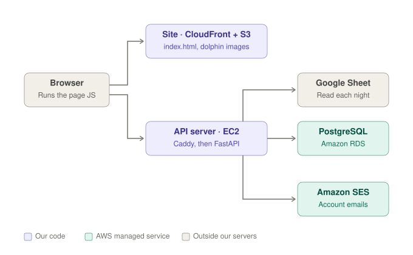
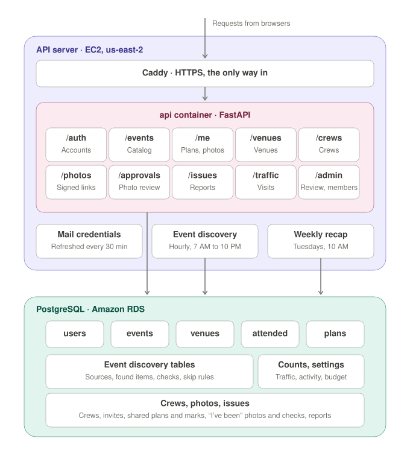
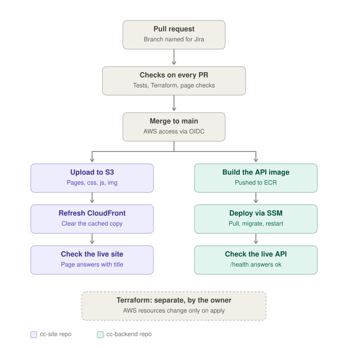

# Culture Crew: app structure

This document uses the rules of ASD-STE100 Simplified Technical English. No STE checker has verified it.

## Diagrams

The overview shows the parts and how they connect.

This diagram shows what runs on the API server and the tables in the database.

This diagram shows how a change goes from a pull request to production.

## 1. General

The Culture Crew app shows a list of cultural events in Chicago.
The app has two main parts: the site and the API.
The site shows the data. The API keeps the data.
Each part has its own repository on GitHub.

| Part | Repository | Function |
|---|---|---|
| Site | `cc-site` | Shows events to the user. Sends the user's actions to the API. |
| API | `cc-backend` | Keeps the events, users, plans and venues. Finds new events. Sends emails. |
| Infrastructure | `cc-backend/infra/aws` | Defines the AWS resources. |

## 2. The site

The site has these files:
- `public/index.html`: the HTML.
- `public/css/site.css`: the styles.
- `public/js/`: the scripts, one file for each area of the site.

The page loads the scripts in a fixed order. All the scripts share one global scope.
The site does not have a build step. At deploy, a script adds a content hash to each link to a style or script file.
Thus, browsers can keep these files for one year and still get each new version.

Amazon S3 keeps the files.
Amazon CloudFront sends the files to the user's browser.
The browser runs the JavaScript.
The JavaScript gets the data from the API.

The site has these views:
- Home
- Catalog
- Plan an outing
- Submit an event
- Your account
- Review (admins only)
- Venues, with each venue's hours (admins only)
- Site stats (admins only)
- Event sources (admins only)
- Found events (admins only)
- Issues (admins only)

The site has two themes: dark and light.
The user can change the theme with the theme button.

## 3. The API

The API uses Python and FastAPI.
The API runs in a Docker container on one Amazon EC2 server.
Caddy receives each request first. Caddy then sends the request to the API.
Caddy also gives the HTTPS certificate.

The API has these groups of routes:

| Routes | Function | Who can use them |
|---|---|---|
| `/auth` | Sign in, sign out, register, confirm email, reset password | All users |
| `/events` | Show, search, submit, edit and delete events | All users can read. Admins can edit and delete. |
| `/me` | "I've been" marks and their photos, plans, the user's submissions, which crews can see each plan | The signed-in user only |
| `/photos` | Show one "I've been" photo | Anyone with a signed link (15 minutes) |
| `/approvals` | The photos waiting for approval; approve or reject one | Approvers and admins |
| `/admin/members` | Offer or remove the approver permission | Admins only |
| `/admin` | Review queue, scheduled events, withdrawn events, site stats | Admins only |
| `/admin/discovery` | Event sources, found events, skip rules, the CSV download, the monthly budget | Admins only |
| `/venues` | Show, rename, merge and delete venues. Set opening hours and show times. | All users can read. Admins can change. |
| `/crews` | Start a crew, make invite links, invite by email, accept or decline an invite, join, leave. The owner renames, removes members, hands over or deletes. | Signed-in users. Only a crew's members can see it. |
| `/issues` | Report a problem with the site. Admins see the reports at `/admin/issues`, set a status and add a note. | Signed-in users report. Admins review. |
| `/traffic` | Count a page view, a click to an event's page, or a planned outing. No cookies. | All visitors (the site sends it) |

## 4. The database

The database is PostgreSQL 16 on Amazon RDS.
Only the API can connect to the database.
Alembic controls changes to the database structure.
Each change is a numbered migration in `cc-backend/alembic/versions`.
The deploy applies new migrations automatically.

The database has these main tables:
- `users`: the accounts, with each account's role (user or admin) and the approver permission. `refresh_tokens` and `email_tokens` keep the sign-ins and the email links.
- `events`: the events. Each event also keeps its schedule: the dates and times that discovery found, and its usual show times.
- `venues`: the places where the events occur. Each venue keeps its opening hours, its usual show times and its standard cost. If an event does not post a price, the catalog shows the venue's standard cost ("Usually free"), and the price filters and the price sort use it. An event's own price always comes first. The standard cost is not copied into the events.
- `attended`: the "I've been" marks.
- `went_photos` and `photo_checks`: the photos that members add to "I've been" marks, and each Amazon Rekognition check (for the daily limit and the monthly cost).
- `plans`: the "interested" and "going" plans.
- `crews`, `crew_members` and `crew_invites`: the culture crews. An invite keeps only a hash of its link.
- `crew_email_invites`: invites to a crew by email address. The person with that address sees the invite when they sign in. The inviter does not learn if the address has an account.
- `plan_shares`: which crews can see a plan. A plan is private until its owner shares it. Only the members of those crews see it.
- `attended_shares`: which crews see an "I've been" mark: the crews that the plan was shared with when its owner marked it. The crew box shows who has been, with 📸 for an approved photo and 📷 for none or one waiting. A closed event stays on the crew box for 2 weeks while someone has been.
- `discovery_sources`, `discovered_items`, `discovery_checks` and `discovery_skip_rules`: event discovery (section 5).
- `traffic_counts`, `traffic_visitors`, `traffic_visitor_days` and `user_active_days`: the counts for Site stats. These tables do not keep names or IP addresses.
- `issue_reports`: problems that members reported, with a status and an optional note for the member.
- `app_settings`: settings that an admin can change, for example the discovery budget.
- `sheet_syncs`: the history of the old Google Sheet sync. Nothing writes to this table now.

## 5. Event discovery

Event discovery finds new events on the venues' own websites.
EventBridge Scheduler starts discovery one time each hour, from 7 AM to 10 PM Chicago time. Discovery runs in the api container.
Each source has a date for its next check. Discovery reads only the sources that are due. Most hours, no source is due.
Discovery reads a page again only when the page changed.

Discovery reads each changed page in this sequence:
1. If the page has complete schema.org event data (dates and a price), discovery uses that data. This costs nothing.
2. If not, Claude Haiku (on the Anthropic API) reads the page and lists the events. The Art Institute has its own API, so discovery uses that API.

Discovery puts each event that it finds in a holding list. Discovery does not put events on the site.
An admin approves or rejects each event on the "Found events" page.
About 60 and 45 days before an event opens, discovery reads the event's own page for the prices and the showtimes.

**Missing dates and show days:** an event must have a date before an admin can approve it. A performance (Theater, Comedy or Concert) must also have start times: its show days with times, dated performances with times, or the venue's usual show times. An open run with show days, such as a weekly open mic, does not need a date. If a found event does not have these, Found events marks it "Needs a date" or "Needs show days". Discovery then reads the event's own page on the next day, and then each week for 4 weeks. The event stays marked until an admin adds what is missing in the approve form, or rejects it. The weekly recap shows how many events are marked.

**Show days:** a performance has the days of the week that it is on, and one or more start times for each day. A day can be on some weeks of the month only: the 1st, 2nd, 3rd, 4th or last (for example, the 1st and 3rd Thursday). Plan an outing suggests only those weeks. The opening and closing dates do not change. Admins set the show days in the event forms. Members can give them in "Submit an event" (optional). Claude reads them from pages such as "Thursdays to Saturdays at 8 PM". The catalog cards show them under the venue.
Discovery also fills in the venues' opening hours and usual show times. Discovery does not change hours that an admin set.

> **NOTE:** The Anthropic API key is in AWS SSM Parameter Store. The scheduled job gives the key to discovery on standard input. The key is not in the code, on a command line or in a file.

**Monthly budget:** discovery costs about $5 each month. The default budget is $10. At 80% of the budget, the event pages wait until the next month. At 100%, discovery reads only the sources that an admin asks for with "Check now".

**Check by hand only:** some sites do not let discovery read them. An admin can set such a site to "Check by hand only". Discovery then does not try the site. The weekly recap shows the site in its "Check these by hand" list.

> **NOTE:** Until October 2026, a Google Sheet was the second source of events. The site does not read the sheet now. The sheet is a read-only archive. The old sheet events are ordinary events, and you can edit them on the site.

## 6. Photos with "I've been"

A member can add a photo to an "I've been" mark. The photo is optional. Each mark has one photo; a new photo replaces the old one.

The photo goes through these steps:
1. The browser shrinks the photo (longest side 1600 pixels) and draws it again as a JPEG. This removes the location and camera details.
2. The API sends the photo to Amazon Rekognition content moderation ($0.001 for each photo). If Rekognition is 90% sure that the photo is explicit, graphically violent or hateful, the API refuses the photo. A refused photo is never stored.
3. The API stores the photo in a private S3 bucket (encrypted, no public access). If Rekognition found other content, the photo is blurred for approvers.
4. The photo waits for an approver.

**Approvers:** a member can hold the approver permission. Only an admin can offer it (on the Members page), and the member accepts or declines it under "Waiting for you". Admins can always approve. An approver sees Photo approvals: the waiting photos, oldest first, with the event, the member's first name and last initial, and what Rekognition found. Blurred photos stay blurred until the approver chooses to look. The approver approves the photo, or rejects it with an optional reason that the member sees. A rejected photo is deleted from storage. Nobody approves their own photo. The weekly recap shows how many photos are waiting.

Only the member and the approvers can see a photo. Crew-mates see only that the member has been, and whether the photo is approved (📸) or not (📷); they do not see the photo. The API shows a photo only through a link that it signs for 15 minutes. A member can send 10 photos each day. When a member removes the mark, or an admin deletes the event, the photo is deleted. Each hour, the discovery job also deletes stored photos that the database does not know (for example, from a deleted account). Site stats shows the number of checks this month and their cost.

## 7. Plan an outing

Plan an outing suggests only events that occur at the time that the user selects: Today, Tonight, This weekend, Next weekend or a date.
- A performance must have a schedule: its own dates and times, its usual show times, or its venue's show times. If a performance does not have a schedule, Plan an outing does not suggest it. The catalog shows it.
- An exhibition must be open: the venue's opening hours tell when. If the hours are not known, Plan an outing uses 10 AM to 5 PM. For "Tonight", the venue must be open after 6 PM.

The site gets each event's schedule and its venue's hours from the API. Plan an outing does the calculation in the browser.

## 8. Email

The API sends email with Amazon SES in the us-east-1 region.
The API sends four types of email:
- Email confirmation.
- Password reset.
- Crew invites sent to an email address. Each address gets one email per crew while the invite waits, and at most three a day.
- The weekly discovery recap to info@chiculturecrew.com. EventBridge Scheduler starts it on Tuesdays at 10 AM. The recap is an HTML email with a plain-text copy. If the API cannot send it, an alert goes to the product owner.
The API uses short-lived credentials. These credentials can only send email.

SES has production access, so it can send to any address.
Members must confirm their email address before they can send in events or see crew invites sent by email.

## 9. Deployment

GitHub Actions tests each pull request.
When you merge a pull request into `main`, GitHub Actions deploys the change.
GitHub Actions uses OIDC to get access to AWS. It does not keep AWS keys.

Terraform defines the AWS resources: S3 (the site and the photos), CloudFront, EC2, ECR, RDS, SES, Rekognition permissions, Route 53, IAM, EventBridge Scheduler, SSM Parameter Store and CloudWatch.
CloudWatch keeps the logs. If a scheduled job or a deploy fails, CloudWatch sends an alert by email.

> **WARNING:** Only the product owner applies Terraform changes. Do not apply Terraform changes from an automated session.

## 10. Data flow (example: a user marks an event "Interested")

1. The user clicks "Interested?" on an event card.
2. The browser sends `PUT /me/plans/{event_id}` to the API.
3. The API makes sure that the user is signed in.
4. The API writes the plan to the `plans` table.
5. The API sends the plan back to the browser.
6. The site shows the dolphin next to the date on the card.
